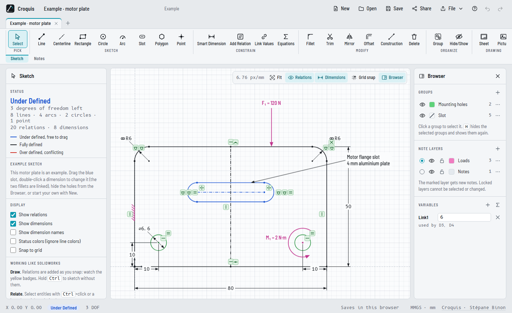
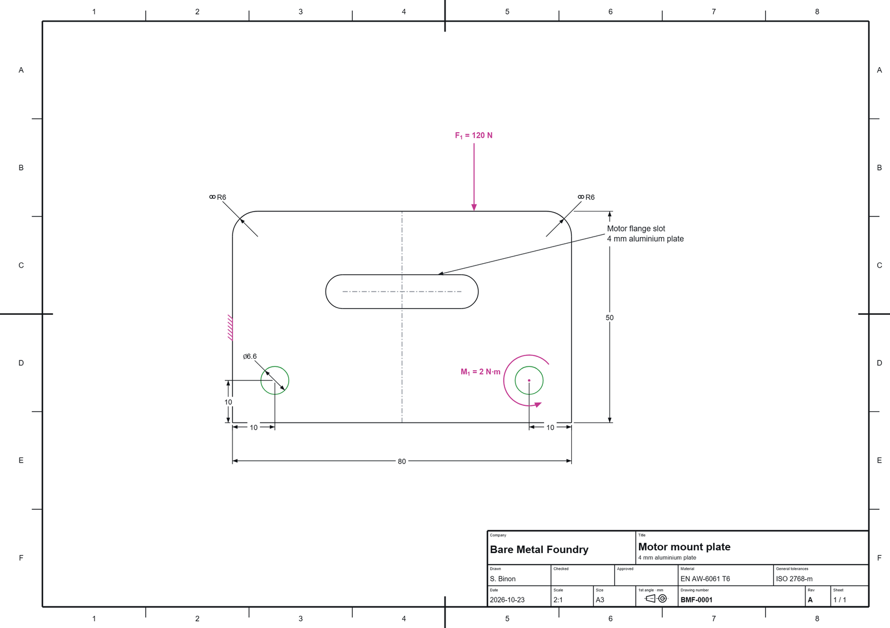
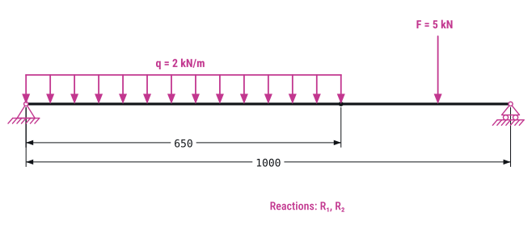

# Croquis

**Quick constrained 2D sketches and schematics — in your browser, nothing to install.**

Croquis (French for *sketch*) is for explaining how a system works with a fast 2D drawing. Sketch lines, arcs and circles, tie them together with relations and dimensions, then **drag the sketch by hand** and watch it move as the constraints allow. Add forces, torques and supports, and export a PDF, SVG, DXF or a TikZ figure for your report.

Croquis is **not a CAD system**. Its sketcher borrows the relations and dimensions of tools like SolidWorks, but the goal is speed and clarity: schematics and illustrations that only need 2D views.

### ▶ [Open Croquis](https://bare-metal-foundry.github.io/croquis/)

**For scripts and AI agents:** the same solver and renderer run headless in Node.js 18+, with no dependencies. Describe a sketch in JSON, get an exact SVG / PDF / TikZ figure and a report that says whether it is fully defined:

```sh
npx github:Bare-Metal-Foundry/croquis example > spec.json
npx github:Bare-Metal-Foundry/croquis build spec.json --svg figure.svg --pdf figure.pdf --require-full
```

→ [Headless API and description format](docs/API.md) · [Examples](docs/examples/) · [llms.txt](llms.txt)



---

## Features

**Sketch**
- Line, centerline, rectangle (corner, center, 3‑point), circle, arc (centerpoint, tangent, 3‑point), slot, polygon, point.
- Relations are added as you draw (horizontal, vertical, coincident, midpoint, tangent…), shown as small badges you can select and delete.
- Under-defined geometry is blue and can be dragged; fully defined geometry turns black; conflicts turn red. The Properties panel counts the degrees of freedom left.
- **Millimetres or inches**, per drawing (the unit button in the footer). Type `2in` or `50 mm` anywhere to mix units.
- **Fills**: give a circle or any closed outline a fill colour and transparency (select one edge, pick a colour under *Line format*). Fill a hole with the same colour to cut it out of the shape around it.

**Constrain**
- Smart Dimension: lengths, distances, angles, radii and diameters. Double-click a dimension to type a new value.
- Equations and global variables: type `=D1/2` or `=thickness*2 + 1` in any dimension. Units (`mm`, `cm`, `m`, `in`, `deg`) and functions (`sin`, `sqrt`, `min`…) work.
- Link Values: several dimensions share one value.

**Modify**
- Fillet, Trim (click or drag across), Mirror (stays symmetric), Construction geometry.
- **Offset**: point at an outline, move to the side you want and click. The whole chain is copied at a distance, sharp corners are extended or trimmed, smooth joints stay tangent, and one *Offset* dimension drives the copy (bi-directional and "make the original construction" options included).

**Annotate** — text notes with leaders, forces, torques, distributed loads, supports (fixed, pinned, roller), springs, dampers, coordinate frames and centers of mass. Notes stay attached to the geometry and live on layers you can hide and lock.

**Drawing sheets** (optional, for when a framed print is needed) — A4, A3, A2, A1, A0, US Letter and Tabloid, landscape or portrait, at a standard scale (50:1 to 1:1000, or custom). The sheet has an ISO 5457 frame with grid reference zones and centering marks, and an ISO 7200-style title block: company, title, subtitle, drawing number, revision, date, drawn / checked / approved by, material, general tolerances, sheet number, scale, size and the first- or third-angle projection symbol. *Fit drawing* picks the largest standard scale that fits.



**Trace a sketch** — insert a photo or scan of a hand sketch (button, paste with Ctrl+V, or drag and drop), set its opacity, *Calibrate* it by clicking two points of known distance, lock it and draw over it.

**Export and import**

| Format | What you get |
| --- | --- |
| **PDF** | Vector drawing. With a sheet: the paper at its true scale, frame and title block, ready to print. Without: the drawing at full size. |
| **SVG** | Vector drawing (the whole sheet when one is shown). |
| **PNG** | Image at up to 200 dpi. |
| **DXF** | Lines, arcs, circles and points for CAD/CAM, with groups and note layers as DXF layers, line types and colors. |
| **TikZ** | A `tikzpicture` (or a standalone `.tex`) for LaTeX: true-to-scale geometry, dimensions and notes, text in your document font. Fit to a width in cm, full size, or the whole sheet. |
| **JSON** | The native sketch file, with every relation, dimension, equation and picture. Import it back, or import a **DXF**. |

**A clean workspace** — one click hides the grid, another goes full screen, and the tutorial texts (tips, how-to and panel explanations) can be switched off from Display or the **?** menu once you know your way around. A light / dark switch (it starts from your system setting).

**Several drawings at once** — every drawing opens in its own tab, with its own undo history. Open tabs and their contents come back when you return.

**Share and embed** — *Share* gives you:
- a **view-only link**: the drawing opens read-only, with pan and zoom;
- an **editable link**: the drawing opens as a copy in the recipient's editor;
- an **embed code** (`<iframe>`) for docs tools that accept iframes (Notion, Confluence, GitBook, MkDocs, Docusaurus, WordPress…);
- a **live embed** from a `.json` file you host (for example in a GitHub repository): update the file and every page that embeds it shows the new version.

The drawing travels inside the link itself, after the `#`, compressed. There is no server: nothing is uploaded, and an editable link gives the other person their own copy — it is not real-time co-editing. Pictures are not included in links (use the `.json` file for those).

**Private by design** — Croquis is a single HTML page. Your drawings are saved in your browser (local storage and IndexedDB) and never leave your device unless you export or share them.

## Getting started

1. Open the [app](https://bare-metal-foundry.github.io/croquis/). An example motor plate is loaded: drag the blue slot, double-click a dimension, or hide the holes from the Browser.
2. Press **New** (or the **+** next to the tabs) for a blank drawing.
3. Draw with the Sketch tools, add dimensions with **D**, and watch the status go from *Under Defined* to *Fully Defined*.
4. **Sheet** (Drawing group) adds a paper sheet and title block; **File › Export PDF drawing** prints it.

### Keyboard shortcuts

| Key | Action | Key | Action |
| --- | --- | --- | --- |
| `L` | Line | `D` | Smart Dimension |
| `Shift+L` | Centerline | `E` | Fillet |
| `R` | Rectangle | `T` | Trim |
| `C` | Circle | `M` | Mirror |
| `A` | Arc | `O` | Offset |
| `P` | Point | `N` | Text note |
| `Q` | Toggle construction | `H` / `Shift+H` | Hide selection / show all |
| `Ctrl+G` | Group | `G` | Snap to grid |
| `F` | Zoom to fit | `Ctrl+V` | Paste a picture to trace |
| `Ctrl+Z` / `Ctrl+Y` | Undo / redo | `Ctrl+S` | Save |
| `Esc` | Cancel, back to Select | `Ctrl` (hold) | Sketch without automatic relations |

Wheel to zoom; middle or right drag (or Space + drag) to pan. The unit switch, grid, snap and fit buttons and the zoom sit at the foot of the toolbar; the open drawings are listed at the bottom of the left panel. Help › Keyboard shortcuts shows this list in the app.

## Using a drawing in LaTeX

**File › Export for LaTeX** writes a `tikzpicture`. Put it in your report:

```latex
\usepackage{tikz}   % in the preamble
...
\begin{figure}[ht]
  \centering
  \input{motor-plate.tex}
  \caption{Motor mount plate}
\end{figure}
```

Choose *Fit a width* to size the figure for your page (dimension values always show the real sizes), or *Standalone document* to compile it on its own.

## Embedding in documentation

A snapshot embed (the code comes from **Share › Embed in a doc**):

```html
<iframe src="https://bare-metal-foundry.github.io/croquis/#embed=…" width="100%" height="420"
        style="border:1px solid #d0d5db;border-radius:8px" loading="lazy"></iframe>
```

A live embed reads a `.json` export you host, so it always shows the latest version:

```html
<iframe src="https://bare-metal-foundry.github.io/croquis/#embed&src=https%3A%2F%2Fraw.githubusercontent.com%2Fyou%2Fdocs%2Fmain%2Fbracket.json"
        width="100%" height="420" loading="lazy"></iframe>
```

Options you can add to the link: `&dims=0` hides dimensions, `&notes=0` hides notes, `&sheet=0` hides the drawing sheet, `&theme=light` or `&theme=dark` forces a theme, `&rel=1` shows relation badges. The file must be served with CORS enabled, as GitHub raw files and Gists are. (GitHub README files do not allow iframes; use an exported SVG there.)

## Generate figures from code (CLI and library)

[`croquis.mjs`](croquis.mjs) loads the solver and renderer from `index.html` and works without a browser. It is meant for reports, documentation pipelines and AI agents that need geometrically exact figures rather than hand-drawn SVG:

- describe entities (lines, arcs, circles, rectangles, slots, polygons), relations, dimensions, annotations, optional measures and a drawing sheet in JSON;
- Croquis solves the sketch and reports `fully defined` / degrees of freedom left / each conflicting item by its index;
- outputs SVG, PDF, TikZ, DXF, a Croquis `.json` to edit in the app, and a share link.

| Example | Description | Figure |
| --- | --- | --- |
| Crank and slider | [crank-slider.json](docs/examples/crank-slider.json) | [crank-slider.svg](docs/examples/crank-slider.svg) |
| Bracket plate | [bracket-plate.json](docs/examples/bracket-plate.json) | [bracket-plate.svg](docs/examples/bracket-plate.svg) |
| Simply supported beam | [beam.json](docs/examples/beam.json) | [beam.svg](docs/examples/beam.svg) |

The full reference is in [docs/API.md](docs/API.md); `node croquis.mjs help` prints a summary.



## Run it yourself

The web app is one file, `index.html`, with no build step and no dependencies beyond a few Google Fonts. The command-line tool is `croquis.mjs` next to it.

```sh
git clone https://github.com/Bare-Metal-Foundry/croquis.git
cd croquis
python -m http.server 8000      # then open http://localhost:8000
```

Opening `index.html` directly from disk also works. To publish your own copy, enable **GitHub Pages** in the repository settings (*Deploy from a branch*, `main`, `/ (root)`).

## Feedback and feature requests

Ideas, wishes and problems are very welcome — every ticket is read:

- [**Request a feature**](https://github.com/Bare-Metal-Foundry/croquis/issues/new?template=feature_request.yml)
- [**Suggest a design improvement**](https://github.com/Bare-Metal-Foundry/croquis/issues/new?template=design_improvement.yml)
- [**Report a bug**](https://github.com/Bare-Metal-Foundry/croquis/issues/new?template=bug_report.yml)

The same links are in the app under the **?** menu.

## License

Croquis is **free for personal and other noncommercial use** under the [PolyForm Noncommercial License 1.0.0](LICENSE.md): study, hobby projects, school and university work, research, charities and public institutions are all fine, and you may share and modify it for those purposes.

**Commercial use** — using Croquis for profit, inside a company, or as part of a paid product or service — **needs the author's approval.** If that is what you have in mind, just [send me a message on LinkedIn](https://www.linkedin.com/in/stepane-binon/) and we will sort it out.

Croquis is *source-available*, not open source in the OSI sense, because of this noncommercial condition.

## Author

Made by **Stépane Binon**, with the “technical” skills of an LLM, to match the field needs of an engineer.

- LinkedIn: [linkedin.com/in/stepane-binon](https://www.linkedin.com/in/stepane-binon/)
- GitHub: [@StepaneBinon](https://github.com/StepaneBinon) · [Bare Metal Foundry](https://github.com/Bare-Metal-Foundry)

Fonts: [Unbounded](https://fonts.google.com/specimen/Unbounded) (wordmark), [Barlow Semi Condensed](https://fonts.google.com/specimen/Barlow+Semi+Condensed) and [B612 Mono](https://fonts.google.com/specimen/B612+Mono), both under the SIL Open Font License.

© 2026 Stépane Binon
